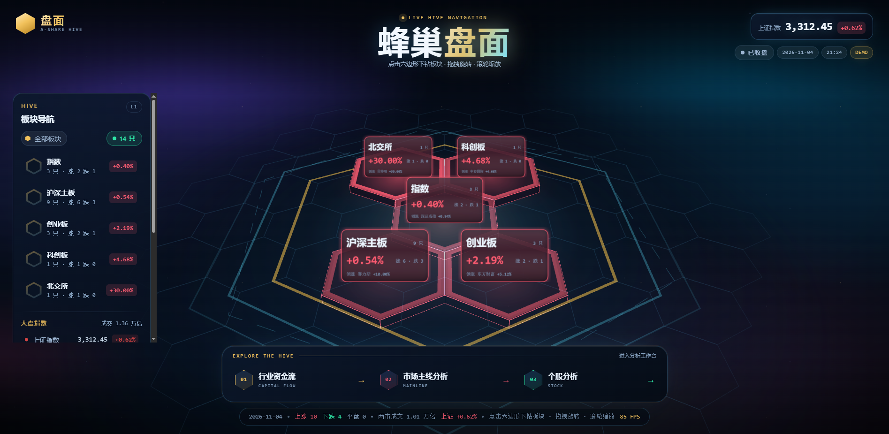

# 盘面 · A 股蜂巢导航台

Vue 3 + TresJS 声明式 Three.js 蜂巢 × Hono 后端，同一套 Zod Schema + 涨跌停规则打通端到端类型。
主体是一张**三维蜂巢导航图**：板块 → 个股两级下钻，URL 即层级。



> 盘面数据为**教学用演示快照**，非实时行情。接口通过 `health.dataMode = 'demo'` 如实标注，
> 顶栏也常驻「演示数据」徽标——避免把静态快照误读成盘中报价。

```
┌──────────────────────────── 浏览器 ─────────────────────────────┐
│ MarketPage (pages)                                              │
│   ├─ HiveCanvas  (widgets) ─ TresCanvas / 六边形瓦片 / 蜂巢地板  │
│   ├─ BoardNav    (widgets) ─ 板块清单 / 指数 / AddWatchPanel     │
│   └─ NodeBrief   (widgets) ─ 选中标的摘要 / 板块内导航 / 关注度   │
│            │            ▲                                       │
│            ▼            │ 板块聚合 + 标的 / Pinia Store           │
│   entities/{market-board, market-node} ── shared/lib/hex         │
│            │            │                                       │
│        shared/api（Zod 反向校验） ── features/navigate-hive       │
└───────────────────────────────┬─────────────────────────────────┘
                                │ fetch + Zod 校验
                    ┌───────────▼───────────┐
                    │ Hono @ :3600          │
                    │ routes → services     │
                    │ @platform/contracts   │
                    └───────────────────────┘
```

## 快速开始

```bash
pnpm install
pnpm dev          # 前端 8080 + 后端 3600（concurrently 同时启动）
```

其他脚本：

| 命令 | 作用 |
| --- | --- |
| `pnpm dev` | 构建共享契约包，然后并行启动 Vite(8080) 与 Hono(3600) |
| `pnpm pm2:start` | 构建契约包后用 PM2 常驻启动 web/api/stockframe，可关闭终端 |
| `pnpm pm2:restart` | 按 ecosystem 配置重新加载三个常驻进程 |
| `pnpm pm2:stop` | 停止三个常驻进程 |
| `pnpm pm2:status` | 查看常驻进程状态 |
| `pnpm pm2:logs` | 持续查看三个进程日志 |
| `pnpm build` | 契约包 → `vue-tsc` 全量类型检查 → `vite build` |
| `pnpm preview` | 预览生产产物（4173，已配置 `/api` 代理） |
| `pnpm test` | Vitest（jsdom）：契约、蜂巢布局、盘面映射、API 客户端 |
| `pnpm lint` / `pnpm lint:fix` | ESLint 9 flat config，含 FSD 边界校验 |
| `pnpm typecheck` | 前端 `vue-tsc` + 构建脚本 tsc + 后端 tsc |
| `pnpm format` | Prettier |

> 端口 8080 被占用时 Vite 会直接报 `Port 8080 is already in use` 并退出（`strictPort` 故意如此），
> 先释放端口再启动；后端端口可用 `PORT=3700 pnpm dev:api` 覆盖。
>
> 后端绑定 3600 时带**退避重试**（24 × 250ms）：`tsx watch` 在多个文件同时变更时会连发两次重启，
> 旧进程尚未释放端口，若此时直接退出，API 会一直死到下一次文件变更（前端只会看到 Vite 代理回 500）。
> 现在这种情况会自动重试并接上，只有端口被外部进程长期占用才会报错退出。
>
> PM2 常驻模式使用项目内 `.pm2` 作为 PM2_HOME（由 `scripts/pm2.cjs` 固定），与全局 PM2 里
> 其他项目的应用互不干扰；日志在 `.pm2/logs/`，关闭终端后进程继续运行。需先确保 `pm2` 已安装到 PATH。

## 蜂巢导航语义

| 概念 | 规则 |
| --- | --- |
| 层级 | `/` 板块层 → `/board/:board` 标的层 → `?node=<id>` 选中某只；浏览器前进/后退天然是「下钻/返回」 |
| 直链 | `?node=<id>` 是分享链接的唯一事实源：冷启动等列表到达后再落位；id 已不存在就摘掉参数；id 属于别的板块则把层级修正到它真正的板块（以更具体的标的为准） |
| 蜂巢几何 | pointy-top 六边形，轴向坐标 `x = √3·r·(q + r/2)`、`z = 1.5·r·r`，与 `CylinderGeometry(r, r, h, 6)` 的顶点朝向一致 |
| 落位 | 同心环填充：环 0 = 中心 1 格，环 n 有 6n 格；末环不满时均匀取样，左右对称不堆在一侧 |
| 涨跌配色 | 红涨绿跌（`--up #ff4d4f` / `--down #00c48c`），平盘走中性灰；UI 装饰色一律用金 `#e8b339`，不与涨跌语义混用 |
| 格子颜色 | 面板近乎纯黑（只透 1% 量级的方向色）+ 方向色棱线 + 方向色内嵌片；涨跌幅越极端棱线越亮 |
| 行情牌排版 | Canvas 贴图 512×320；名称按实测宽度收窄、仍放不下才截断，价格 + 涨跌幅整行按比例缩字号，避免「1,586.00 −0.24%」这种长组合溢出格面 |
| 贴牌抬升 | Sprite 以自身中心定位的竖直四边形，抬升量必须随贴图高度算（`0.04 + 0.34·h`）：写死 0.16 时下半段沉进六棱柱体内被深度测试吃掉，最下面那行「成交额 / 领涨」永远不显示 |
| 涨跌停 | 主板 ±10%、创业板/科创板 ±20%、北交所 ±30%、指数不设限，规则在 `packages/contracts/src/market-rules.ts` |
| 交易时段 | 按 `Asia/Shanghai` 计算盘前 / 集合竞价 / 交易中 / 午间休市 / 已收盘 / 休市 |
| 板块内导航 | 按成交额降序，「上一只 / 下一只」环绕不停，键盘 ← → 同效 |

## 目录与 FSD 约束

```
src/
├── app/       启动、路由、全局样式、Pinia 实例
├── pages/     路由级页面，只做组合
├── widgets/   hive-canvas（3D 蜂巢 + 地板）、board-nav、node-brief、index-strip
├── features/  navigate-hive（路由↔层级）、create-node、tune-node、market-health、market-metrics
├── entities/  market-board（板块聚合）、market-node（模型 + Store + 六边形瓦片）
├── shared/    ui 组件库、api 客户端、lib/hex（蜂巢布局）、lib/three（渲染器、瓦片、后处理）
└── main.ts
server/        Hono 服务，独立 tsconfig 与 package
packages/contracts/  Zod Schema + 涨跌停规则（前后端唯一事实源）
```

`eslint.config.js` 用 `eslint-plugin-boundaries` 把上述层级编译成硬约束：

- 只允许向下依赖（`app → pages → widgets → features → entities → shared`）；
- 同层之间可以互相引用，`shared` 不得反向依赖；
- `packages/contracts` 独立成 `contracts` 分类，任何层都可以消费；
- 第三方依赖（`node_modules`）不受分层限制。

越界导入会直接失败：

```
src/entities/market-node/model/__probe.ts
  1:29  error  FSD 违规：entities 层不允许依赖 widgets 层（依赖只能自上而下）
```

## 3D 渲染管线

- **模板编译**：`vite.config.ts` 必须把 `@tresjs/core/template-compiler-options` 传给 `@vitejs/plugin-vue`。
  `<TresMesh>`、`<TresPerspectiveCamera>` 这些不是 Vue 组件，而是透传给 TresCanvas 自定义渲染器的标签；
  少了这段配置，浏览器会刷屏 `Failed to resolve component: TresXxx`，整棵场景树静默不渲染。
- **蜂巢瓦片**：`shared/lib/three/HexTile.vue` = 六棱柱（约 0.18 厚度）+ `EdgesGeometry` 棱线 + 无光照内嵌色片
  + Canvas 纹理 Sprite 行情牌；悬停抬升 0.18、选中抬升 0.36 并套一圈六边形光环。
- **蜂巢地板**：`HiveFloor.vue` 按轴向坐标铺一片线框蜂巢，外加一个由内向外扩散并淡出的金色扫描环，
  全部在 `useLoop().onBeforeRender` 里直接改变换与材质透明度，不触发 Vue 响应式更新。
- **机位**：按蜂巢外接半径推导距离（`extent · 2.25 + 4`），俯角约 41°，换层时格子既不会溢出也不会缩成一点。
- **拾取**：`<TresMesh @click.stop>` 命中后交给 `features/navigate-hive`，由路由决定下层铺什么。
- **渲染基线**：`shared/lib/three/renderer-preset.ts` 统一 ACES Filmic 色调映射、sRGB 输出、`dpr: [1, 2]`。
- **后处理**：`ScenePostFx.vue` = `EffectComposer → UnrealBloom → Output`，强度由盘面平均波动驱动（`bloomFactor`）。

> 调色陷阱：three 在**线性空间**混合，再经 sRGB 输出。`opacity: 0.05` 的纯红屏幕上看起来接近 25%，
> `color × 0.07` 的面板也会被染成红板。所以面板底色用 0.012、内嵌色片用 0.02 量级，
> 方向色主要由棱线与文字承担。

## 接口

| Method | Path | 说明 |
| --- | --- | --- |
| GET | `/api/health` | 运行时、交易时段、交易日、`dataMode`（前端每 20s 轮询） |
| GET | `/api/market/overview` | 三大指数、涨跌家数、两市成交额、主力净流入 |
| GET | `/api/market/boards` | **蜂巢第一层**：板块聚合（家数 / 涨跌 / 成交额 / 均涨幅 / 领涨股） |
| GET | `/api/market/nodes` | 盘面标的列表（指数在前，个股按成交额降序） |
| POST | `/api/market/nodes` | 加入自选（Zod 校验代码/板块匹配，非法入参 400） |
| GET | `/api/market/nodes/:id` | 单个标的 |
| PATCH | `/api/market/nodes/:id` | 更新关注度 |
| GET | `/api/market/nodes/:id/detail` | 成交额排名、同板块家数、涨跌停状态、被检视次数 |

错误统一为 `{ error: { code, message, details? } }`。前端 `shared/api/client.ts` 用同一份 Schema 反向校验响应，
Schema 漂移会立刻变成 `invalid_response` 而不是运行期崩溃。

新增自选时板块校验示例（`SH` 市场不接受 `gem`）：

```json
{ "error": { "code": "validation_error", "message": "请求参数校验失败",
  "details": { "fieldErrors": { "board": ["SH 市场不支持该板块"] } } } }
```

## 构建产物（three 独立分包）

`vite.config.ts` 的 `manualChunks` 把渲染引擎与框架拆开，主包只留业务代码：

```
dist/assets/three-*.js        794 kB   ← three + postprocessing
dist/assets/tres-*.js          66 kB   ← @tresjs/core + cientos
dist/assets/vue-*.js          106 kB
dist/assets/MarketPage-*.js    94 kB
dist/assets/index-*.js        2.1 kB   ← 入口，不含 three
```

## 质量闸门

`pnpm lint` · `pnpm typecheck` · `pnpm test`（53 个用例）· `pnpm build` 全部通过。

其中 `src/features/navigate-hive/use-hive-navigation.test.ts` 用内存路由 + 假 API 锁住四条 URL 语义：
冷启动直链落位、板块与 node 冲突时修正层级、失效 id 摘参、板块内环绕切换。
这组用例的存在理由是一次真实回归——早期版本的 watcher 只依赖 `routeNodeId`，
首屏列表未到时直接 return，而 URL 此后不再变化，于是「复制链接给别人」永远打不开选中态。
